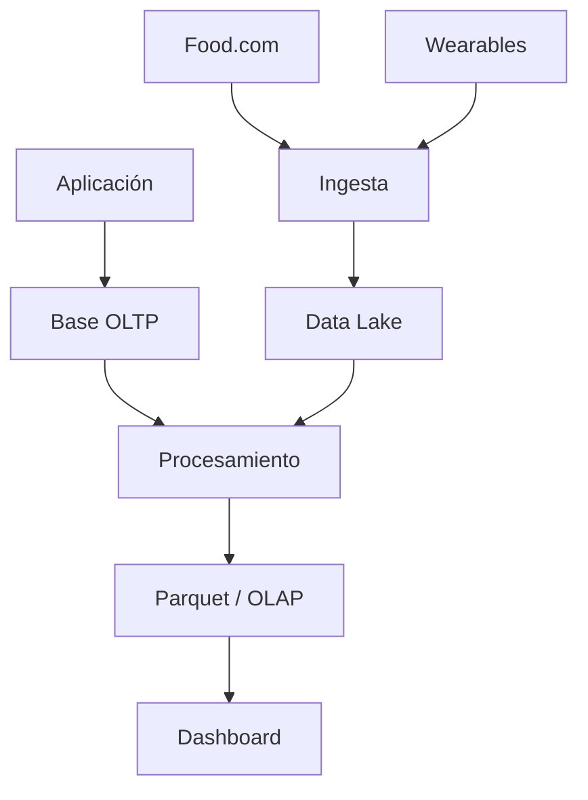
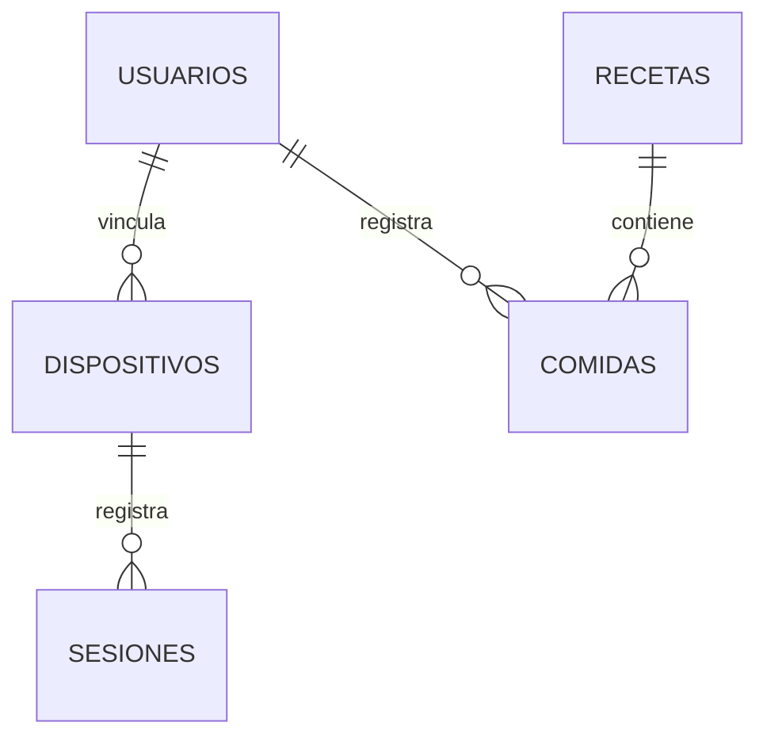
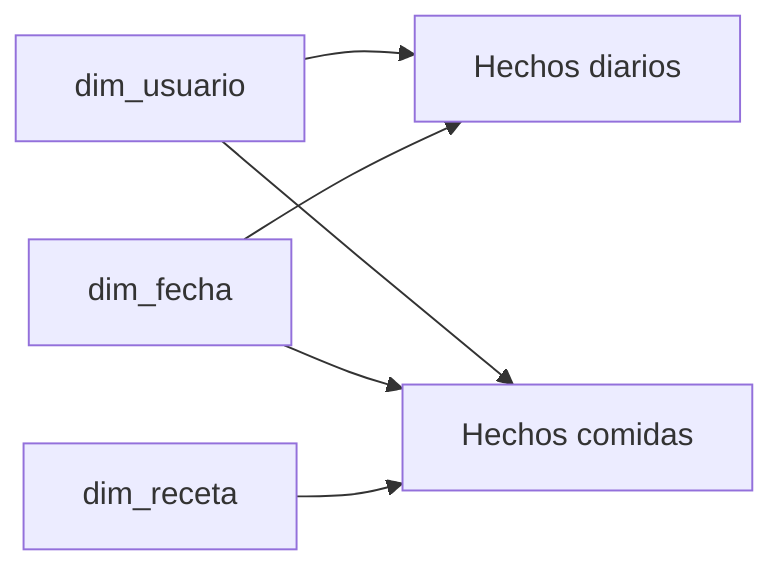

# Entrega 1

Valentina Reyes  
INF3862 — Plataformas Big Data para Data Science  
Magíster en Inteligencia Artificial UC

## 1. Objetivo

El proyecto tiene como objetivo desarrollar un dashboard que permita relacionar la actividad física registrada por dispositivos wearables con las recetas preparadas por los usuarios de Food.com.

Se busca generar indicadores diarios de actividad y alimentación, utilizando datos de recetas, mediciones, sesiones deportivas y comidas. Esto permitirá analizar los hábitos de los usuarios y explorar futuras recomendaciones.

Se considera suficiente una actualización diaria, priorizando la calidad de los datos sobre el procesamiento en tiempo real. Inicialmente se utilizará procesamiento local, con recursos de almacenamiento y cómputo convencionales.

## 2. Fuentes de datos

| Fuente | Datos | Recepción |
|---|---|---|
| Food.com | 522.517 recetas, aproximadamente 700 MB en CSV. | Batch |
| Dispositivos | Relojes vinculados a usuarios. | Transaccional |
| Mediciones | Frecuencia cardíaca, pasos y calorías. | Lotes JSONL |
| Sesiones | Actividades deportivas. | Sincronización |
| Comidas | Recetas preparadas y porciones. | Transaccional |

Cada registro representa una receta, dispositivo, medición, sesión o comida. Los CSV son principalmente estructurados, mientras que los JSONL son semiestructurados.

Los principales problemas esperados son duplicados, datos faltantes, diferencias de formato y mediciones atrasadas.

Los datos originales se conservarán con schema-on-read y las tablas procesadas utilizarán schema-on-write.

El volumen de los archivos wearable debe verificarse. Como supuesto de crecimiento, 10.000 usuarios con 1.000 mediciones diarias generarían 10 millones de registros al día.

## 3. Modelo de datos

### OLTP

Se utilizará un modelo relacional para mantener la integridad entre usuarios, dispositivos, recetas y comidas.

| Tabla | Clave principal | Relaciones |
|---|---|---|
| usuarios | AuthorId | — |
| dispositivos | device_id | AuthorId |
| recetas | RecipeId | — |
| comidas | comida_id | AuthorId, RecipeId |
| sesiones | sesion_id | device_id |

Las tablas incluirán los atributos principales de cada fuente, como fechas, modelos, categorías, porciones y características de las actividades. Los identificadores de comidas y sesiones son claves internas propuestas.

La vinculación de dispositivos requiere una transacción que impida mantener dos vínculos activos simultáneamente.

### OLAP

Se propone una tabla de hechos `fact_actividad_alimentacion_diaria`, con una fila por usuario y día.

Contendrá pasos, calorías estimadas de actividad, sesiones y recetas preparadas. Se relacionará con las dimensiones `dim_usuario` y `dim_fecha`.

También se mantendrá `fact_comidas`, relacionada con `dim_receta`, para conservar el detalle nutricional.

Los archivos originales se almacenarán en un Data Lake. Las tablas analíticas utilizarán Parquet, por su compresión y lectura columnar, con particiones temporales para facilitar las consultas históricas.

## 4. Consultas

### OLTP — Vincular dispositivo

```sql
BEGIN;
-- Validar y bloquear la vinculación actual.
-- Impedir otra vinculación activa.
UPDATE dispositivos
SET AuthorId = :usuario
WHERE device_id = :dispositivo;
COMMIT;
-- Ante un error: ROLLBACK.
```

Corresponde a una escritura puntual, con baja latencia y control de concurrencia. Requiere un índice por dispositivo y una restricción de vinculación única. Sin transacción pueden producirse vínculos inconsistentes.

### OLTP — Registrar comida

```sql
INSERT INTO comidas
(comida_id, AuthorId, RecipeId, fecha_hora, porciones)
VALUES (:id, :usuario, :receta, :fecha, :porciones);
```

Es una operación frecuente sobre un registro individual. Se validarán las claves foráneas para mantener la integridad.

### OLTP — Consultar sesiones

```sql
SELECT s.tipo, s.inicio, s.distancia_km
FROM sesiones s
JOIN dispositivos d ON s.device_id = d.device_id
WHERE d.AuthorId = :usuario
ORDER BY s.inicio DESC
LIMIT 10;
```

Consulta pocos registros y requiere respuesta rápida. Se utilizarán índices por dispositivo y fecha.

### OLAP — Actividad y alimentación diaria

```sql
SELECT fecha_id,
       SUM(pasos_total) AS pasos,
       SUM(calorias_actividad) AS actividad,
       SUM(calorias_recetas_estimadas) AS alimentacion
FROM fact_actividad_alimentacion_diaria
WHERE fecha_id BETWEEN :inicio AND :fin
GROUP BY fecha_id;
```

Permite comparar indicadores históricos y responde al objetivo del proyecto. Se beneficia de Parquet y del particionamiento por fecha.

### OLAP — Actividad mensual

```sql
SELECT DATE_TRUNC('month', fecha_id) AS mes,
       AVG(pasos_total) AS pasos_promedio,
       SUM(sesiones_total) AS sesiones
FROM fact_actividad_alimentacion_diaria
GROUP BY mes;
```

Agrupa grandes cantidades de registros. Puede optimizarse utilizando resúmenes mensuales.

### Frontera OLTP/OLAP — Indicador diario

```sql
SELECT pasos_total, calorias_actividad,
       calorias_recetas_estimadas
FROM fact_actividad_alimentacion_diaria
WHERE usuario_id = :usuario
AND fecha_id = :hoy;
```

Aunque consulta un solo registro, utiliza información analítica. Para evitar afectar la operación, se utilizará una tabla resumen actualizada diariamente e indexada por usuario y fecha.

## 5. Arquitectura



La arquitectura separa la operación del análisis. Inicialmente no se considera necesario incorporar procesamiento distribuido, ya que debe justificarse según el volumen real y los recursos utilizados.

## Anexos

### Modelo operacional



### Modelo analítico


